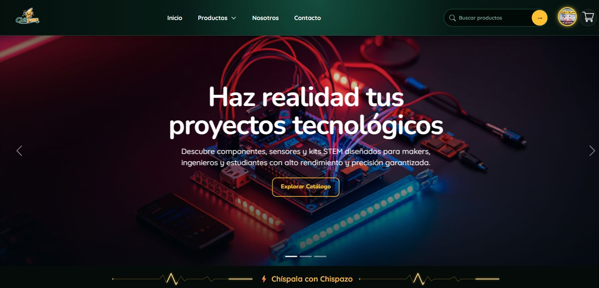

# Chispazo · E-commerce de componentes electrónicos

Aplicación web desarrollada en equipo como proyecto final del bootcamp Java Full Stack de **Generation México · CH70**. Reúne catálogo, herramientas para makers y servicios de backend en un mismo proyecto de aprendizaje.

**[Explorar la demo](https://miguel-asc.github.io/Chispazo/)** · **[Perfil de Miguel](https://github.com/Miguel-ASC)** · **[Portafolio](https://miguel-asc.netlify.app/)**



## Qué puedes explorar

- Catálogo de componentes, búsqueda, categorías y fichas de productos.
- Interfaces de carrito, registro e inicio de sesión y administración.
- Calculadora de resistencias y herramientas para proyectos electrónicos.
- Asistente Chispita, con un servicio Node.js conectado a Gemini.
- API Java para usuarios, productos, categorías, carritos y detalles de carrito.

**Alcance de la demo:** GitHub Pages sirve únicamente HTML, CSS y JavaScript. No ejecuta Spring Boot ni MySQL. Las funciones que requieren la API Java necesitan su despliegue independiente y la configuración del frontend. El chat también depende de un servicio externo. La demo es un proyecto formativo; no representa una tienda con pagos reales verificados.

## Tecnologías

| Parte | Tecnologías |
| --- | --- |
| Frontend | HTML, CSS, JavaScript |
| API de la tienda | Java 17, Spring Boot, Spring Data JPA, Gradle |
| Datos | MySQL; script SQL y diagrama EER incluidos |
| Asistente | Node.js, Express, dotenv, Gemini |
| Colaboración | Git, GitHub, ramas y pull requests; metodología Scrum |

## Estructura

```text
Html/                    Páginas del sitio
css/                     Estilos
js/                      Interacción y conexión con servicios
img/                     Recursos visuales
backend/chispita/        API Java / Spring Boot
chispita-backend/        Servicio Node.js del asistente
index.html               Página de inicio
e_commers_chispazo.sql   Script de base de datos
docs/                    Captura del sitio
```

## Ejecutar el frontend

1. Clona el repositorio:

```sh
git clone https://github.com/Miguel-ASC/Chispazo.git
cd Chispazo
```

2. Sirve la carpeta raíz con Live Server en VS Code o con Python:

```sh
python -m http.server 5500
```

3. Abre `http://localhost:5500/`. Evita abrir el HTML con `file://` para probar peticiones de red.

## Ejecutar la API Java

Requiere **JDK 17**, MySQL y la conectividad necesaria para descargar las dependencias que declara `backend/chispita/build.gradle`.

1. Revisa e importa `e_commers_chispazo.sql` en tu instancia local de MySQL. Consulta el diagrama `Diagrama EER_base de datos_Chispazo.png`.
2. Crea localmente `backend/chispita/src/main/resources/application.properties` con tus datos. Ese archivo está ignorado por Git. No publiques credenciales.

```properties
server.port=8081
spring.datasource.url=jdbc:mysql://localhost:3306/NOMBRE_DE_TU_BASE
spring.datasource.username=TU_USUARIO_LOCAL
spring.datasource.password=TU_CONTRASENA_LOCAL
spring.datasource.driver-class-name=com.mysql.cj.jdbc.Driver
spring.jpa.hibernate.ddl-auto=none
```

3. Inicia el backend desde su carpeta:

```sh
cd backend/chispita
./gradlew bootRun
```

En Windows PowerShell usa `.\gradlew.bat bootRun`.

4. Mantén el frontend en `localhost`. `js/api.js` y `js/cart.js` apuntan a `http://localhost:8081` en ese entorno. Para publicar la API en otro host, ajusta esas bases a la URL correspondiente.

### Rutas de referencia

| Método | Ruta | Uso |
| --- | --- | --- |
| GET | `/productos/mostrar` | Consultar productos |
| GET | `/categorias/mostrar` | Consultar categorías |
| GET | `/usuarios/mostrar-usuarios` | Consultar usuarios |
| POST | `/usuarios/login` | Inicio de sesión |
| GET | `/carritos/mostrar` | Consultar carritos |
| GET | `/detalles-carritos/carrito/{idCarrito}` | Consultar detalles de un carrito |

Las rutas reflejan los controladores actuales. Revisa su código para conocer los cuerpos de las peticiones y las respuestas.

## Ejecutar el asistente Chispita

Requiere Node.js con `fetch` global y npm. Usa una versión LTS compatible con las dependencias del proyecto.

```sh
cd chispita-backend
npm install
```

Crea un `.env` local en esa carpeta:

```dotenv
GEMINI_API_KEY=TU_CLAVE_LOCAL
PORT=3000
```

Ejecuta `npm start`. El servicio expone `POST http://localhost:3000/api/chispita`. Sirve el frontend desde la raíz del repositorio en otro puerto, por ejemplo 5500; el servidor del chat no sirve por sí solo todo el sitio. No subas el `.env` ni la clave a GitHub. El proveedor puede aplicar cuotas o cargos según tu cuenta.

## Verificación y límites actuales

- El backend Java incluye una prueba de carga del contexto; necesita una configuración de base de datos apropiada. Puedes ejecutarla con `./gradlew test` desde `backend/chispita`.
- El servicio Node.js no tiene una suite automatizada: su script `npm test` es un marcador pendiente.
- No se afirma que todos los flujos de compra, persistencia o administración estén disponibles en GitHub Pages.
- La configuración local de la base de datos no se incluye. Comprueba las versiones declaradas de las dependencias antes de ejecutar en un entorno nuevo.

## Equipo y autoría

Proyecto realizado con Aldo Briones Martínez, Alfonso Plaza Esquivel, Ailton Omar Garrido García, Ana Valeria Reyna Peña, Daniela Avigail Varela Alvarado, Enrique Calderón Santana, Jessica Ángeles Resendiz Arroyo, Miguel Ángel Sánchez Cruz, Uriel Franco Jaramillo y Valeria Abigail González Sada.

Este repositorio conserva el historial colectivo. **Miguel Ángel Sánchez Cruz participa como integrante del equipo**; las contribuciones concretas se pueden consultar en [sus commits](https://github.com/Miguel-ASC/Chispazo/commits?author=Miguel-ASC) y [pull requests](https://github.com/Miguel-ASC/Chispazo/pulls?q=is%3Apr+author%3AMiguel-ASC). La descripción del conjunto no atribuye a una sola persona todo el desarrollo.

## Continuar el proyecto

Lee [CONTRIBUTING.md](CONTRIBUTING.md) para proponer cambios pequeños, documentados y verificables.
